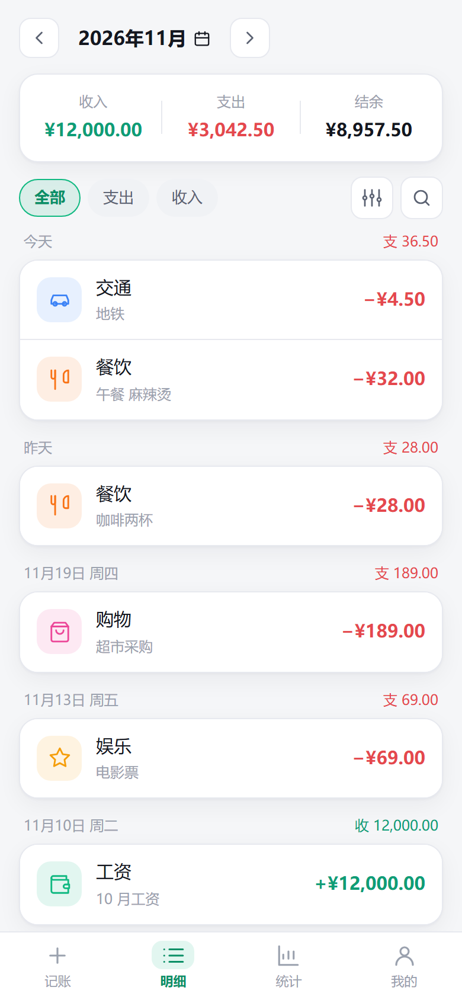
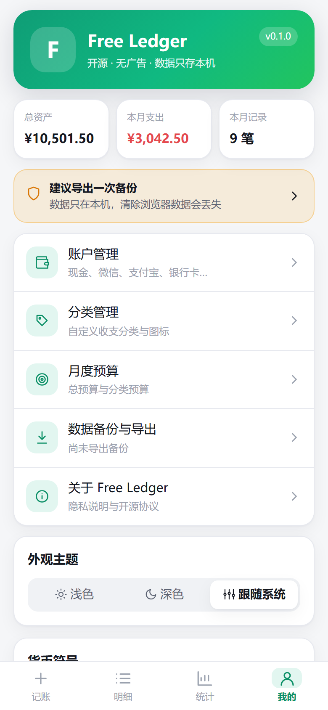
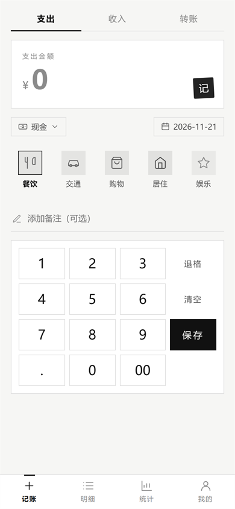
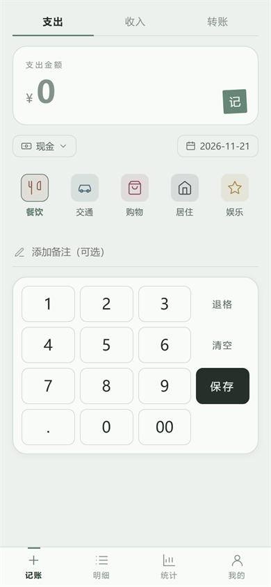
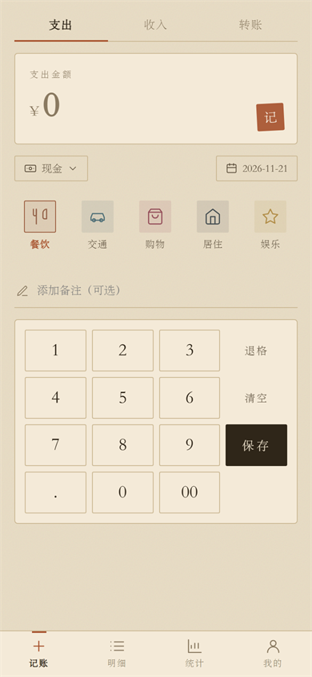
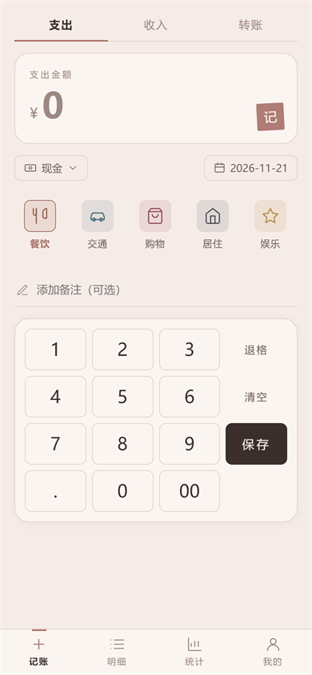
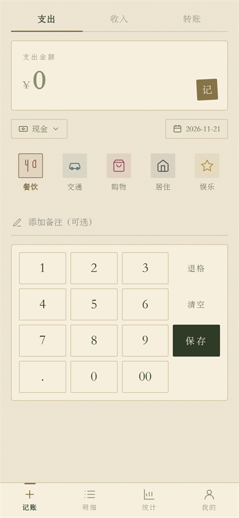
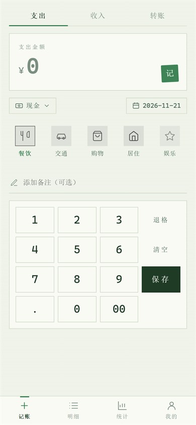
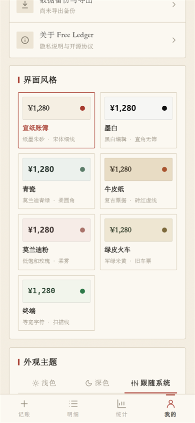
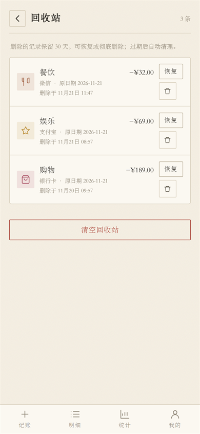

# Free Ledger · 自由记账

[](LICENSE)
[](https://mowendao.github.io/free-ledger/)
[](https://github.com/Mowendao/free-ledger/actions/workflows/deploy.yml)
[](https://web.dev/progressive-web-apps/)
[](#隐私承诺)
[](#隐私承诺)

**Free Ledger** 是一款开源、免费、无广告、无会员、**数据只存本机**的手机记账应用。
交互参考「鲨鱼记账」的快速记账与「随手记」的明细/统计，但没有任何账号体系、云同步和付费墙。

> Free as in freedom, and free as in beer.

## 为什么做这个

记账小程序已经很多，但它们的账本在平台服务器上：要登录、可能有广告或会员、数据难以完整导出、平台下架就没了。

Free Ledger 不追求功能更多，只坚持另一种取舍：**账本是你的文件，不是平台里的账号**。
不登录、不联网、无广告、无会员；数据在浏览器本地，随时导出 JSON / CSV；代码 MIT，可审计、可自建。
它不需要取代谁，只服务"数据必须在自己手里"的那部分需求。

### 小而美的边界

- 只做三类改动：**数据所有权**（导入 / 导出 / 本地）、**降低摩擦**（账单导入、规则）、**可靠性**（测试 / 备份 / 可访问性）。
- 不加入账号体系、云同步、广告、会员、社区、理财商城。
- 新功能必须能在断网、无账号的前提下完整使用。

## 特性

- **快速记账**：支出 / 收入 / 转账，自绘数字键盘，3 次点击完成一笔记账。
- **明细清晰**：按月分组、按日小计、类型/分类/账户筛选；全时段搜索备注、分类、账户、日期与金额，支持金额区间。
- **统计分析**：月度收支汇总、分类占比环形图、近 6 个月趋势柱状图。
- **预算管理**：月度总预算 + 分类预算，进度条与超支提示。
- **账户体系**：现金 / 微信 / 支付宝 / 银行卡 / 信用卡，余额实时计算（含转账）。
- **分类自定义**：名称、图标、颜色全部可改，内置分类受保护；删除已用分类时可先把流水迁移到其他分类。
- **数据自主**：JSON 全量备份（覆盖 / 合并导入）、CSV 导出、一键清空。
- **数据安全**：申请持久化存储、显示空间配额；删除流水进入回收站，可在「我的 → 回收站」恢复或彻底删除（保留 30 天）。
- **微信账单导入**：微信官方导出的 CSV / Excel 在本机解析，自动区分收支、跳过不计收支，统一记为「未分类」，可筛选后逐笔修改；同一商户分过一次类后会记住规则，下次自动归类。
- **离线可用**：PWA 安装到主屏幕，断网也能完整使用。
- **深色模式**：浅色 / 深色 / 跟随系统。
- **零外部依赖请求**：不加载 CDN、字体、统计脚本，生产构建注入 CSP。
- **七种界面风格**：宣纸账簿 / 墨白 / 青瓷 / 牛皮纸 / 莫兰迪粉 / 绿皮火车 / 终端；折叠面板按需展开，选择随备份迁移。

## 界面预览

<p align="center">
  
  
  
  
</p>

> 以上为演示数据截图；实际数据只保存在你自己的设备上。

## 界面风格

内置七种风格，在「我的 → 界面风格」随时切换；选择保存在本机，并随 JSON 备份迁移。
每种风格都各有浅色 / 深色两套色板。

<p align="center">
  
  
  
  
  
  
  
</p>

| 风格 | 气质 |
|---|---|
| **宣纸账簿**（默认） | 纸墨朱砂、宋体细线，1px 分栏 |
| **墨白** | 纯黑白编辑排版、直角无饰、图标灰度 |
| **青瓷** | 莫兰迪青绿、柔圆角、轻阴影、胶囊标签 |
| **牛皮纸** | 复古票据、砖红强调、虚线分栏、双线页头 |
| **莫兰迪粉** | 低饱和玫瑰、柔雾感、圆角卡片 |
| **绿皮火车** | 军绿米黄、旧车票质感、双线页头 |
| **终端** | 等宽字符、扫描线、打印纸与荧光屏 |

## 设计语言

不追求"模板感"：不用渐变、玻璃拟态与糖果色。视觉元素来自纸、墨、印章与细线；
分类色取自赭石、花青、胭脂、藤黄、竹青等传统色。完整规则见 [docs/design.md](docs/design.md)。

## 隐私承诺

- 所有账目、账户、预算只保存在**本机浏览器的 IndexedDB** 中。
- 不注册账号、不连接服务器、不上传任何数据，运行期网络请求为零。
- 无广告、无会员、无内购、无第三方统计。
- 代码完全开源（MIT），可自行审计、自行构建、自行部署。

详细说明见 [docs/privacy.md](docs/privacy.md)。

> ⚠️ **重要**：Free Ledger 不保存任何数据副本。清除浏览器站点数据、卸载浏览器或更换设备都会导致本机账目丢失。
> 请定期在「我的 → 数据备份与导出」中导出 JSON 备份，并保存到自己的网盘或移动硬盘。

## 快速开始

**在线体验**：<https://mowendao.github.io/free-ledger/>（手机浏览器打开可添加到主屏幕）

环境要求：Node.js ≥ 20.19（推荐 22 / 24）。

```bash
npm install
npm run dev        # 开发服务器 http://localhost:5173
npm run build      # 生产构建，输出到 dist/
npm run preview    # 本地预览生产构建
npm test           # Vitest 单元 / 组件测试
npm run lint       # ESLint
npm run test:e2e   # Playwright E2E（需先 build）
npm run typecheck  # vue-tsc 类型检查
```

## 安装到手机

PWA 需要 **HTTPS**（或 localhost）才能注册 Service Worker 并安装：

1. 用手机浏览器打开部署好的 HTTPS 地址；
2. Android Chrome：菜单 →「添加到主屏幕 / 安装应用」；
3. iOS Safari：分享 →「添加到主屏幕」；
4. 之后从桌面图标启动，即可以独立窗口、离线运行。

局域网 `http://192.168.x.x:5173` 仅适合调试：可以浏览和记账，但无法安装与离线。

## 部署

### GitHub Pages（推荐）

仓库已内置 `.github/workflows/deploy.yml`：推送到 `main` 会自动：

1. `npm ci` → 运行测试 → 以 `BASE_URL=/free-ledger/` 构建；
2. 发布到 GitHub Pages（Settings → Pages → Source 选择 **GitHub Actions**）。

仓库地址：<https://github.com/Mowendao/free-ledger>

### 其他静态托管

`dist/` 是纯静态产物，可部署到任意静态托管（Vercel / Netlify / Cloudflare Pages / 自建 Nginx）。
部署在子路径时设置环境变量 `BASE_URL=/your-sub-path/` 再构建。

## 数据备份

导出的 JSON 结构稳定，便于长期保存与迁移：

```json
{
  "app": "free-ledger",
  "schemaVersion": 1,
  "exportedAt": "2026-11-21T02:00:00.000Z",
  "data": {
    "accounts": [],
    "categories": [],
    "transactions": [],
    "budgets": [],
    "settings": []
  }
}
```

- **覆盖导入**：清空当前数据后完整恢复，适合换机迁移；覆盖前会自动导出当前数据。
- **合并导入**：保留现有数据，按 `id` 去重并保留更新时间较新的记录。
- 导入时会校验应用标识、版本、字段类型、日期与账户/分类引用；错误逐条汇总，非法文件会被拒绝，不会污染现有数据。
- **持久化存储**：数据页可申请，显示已用空间与配额；但浏览器仍可能清理，请定期导出。
- **删除回收站**：删除流水进入回收站（不进入统计与备份），可在「我的 → 回收站」恢复或彻底删除，30 天后自动清理。

<p align="center">
  
</p>

### 导入微信账单

微信没有开放个人账单接口，**无法自动同步**。支持官方导出的 CSV / Excel 手动导入：

1. 微信 → 我 → 服务 → 钱包 → 账单 → 右上角「常见问题」→ 下载账单；
2. 选择「用于个人对账」与时间范围，账单会发送到邮箱；
3. 解压得到 CSV 或 xlsx，在「我的 → 数据备份与导出 → 导入微信账单」选择文件；
4. 选择记入账户并确认；记录统一为「未分类」，在明细筛选「未分类」逐笔修改。

解析与导入完全在本机完成，文件不会上传；CSV 兼容 UTF-8 / GBK，xlsx 在本机解压解析；按交易单号去重，重复导入不会产生重复流水。

给某笔流水选好分类后，App 会记住「商户 → 分类」；下次导入同一商户时自动套用。规则只存在本机、随备份迁移，可在数据页一键清除。

## 项目结构

```
.
├─ src/                    # 应用源码
│  ├─ db/                  # Dexie 实例、表结构、种子数据
│  ├─ repositories/        # 数据访问层（唯一直接操作 Dexie 的地方）
│  ├─ services/            # 金额、日期、统计、备份、存储状态等
│  ├─ stores/              # Pinia 状态
│  ├─ components/          # 通用组件（键盘、图表、弹层…）
│  ├─ pages/               # 页面
│  └─ styles/              # 设计令牌与基础样式
├─ tests/                  # Vitest 单元 / 组件 / 冒烟测试
├─ e2e/                    # Playwright 端到端测试
├─ public/                 # 图标与静态资源
├─ docs/                   # 架构、数据模型、隐私说明
└─ .github/workflows/      # CI 与 Pages 部署
```

更详细的分层与数据流见 [docs/architecture.md](docs/architecture.md)，
表结构与不变量见 [docs/data-model.md](docs/data-model.md)。

## 技术栈

Vue 3 · TypeScript · Vite 7 · vue-router（hash）· Pinia · Dexie 4（IndexedDB）·
vite-plugin-pwa · Vitest + jsdom · ESLint · Playwright · fflate（本机解压 xlsx）。样式为手写 CSS 设计令牌，图表为自制 SVG，不引入 UI 库与图表库。

## 路线图

- [x] v0.1 核心记账、明细、账户、分类、预算、统计、备份、PWA
- [ ] 周期账单（房租 / 订阅自动记账）
- [ ] 多账本（日常 / 旅行 / 项目）
- [ ] 标签与多条件组合筛选
- [ ] Capacitor 打包 Android / iOS（复用同一套代码，本地 SQLite）
- [ ] 数据加密（可选口令）

## 参与贡献

欢迎 Issue 与 PR。提交前请确保 `npm test` 与 `npm run typecheck` 通过；
请保持「无广告、无会员、不联网、本地存储」的产品底线。详见 [CONTRIBUTING.md](CONTRIBUTING.md)。

## License

[MIT](LICENSE) © 2026 Mowendao
